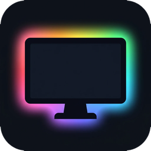
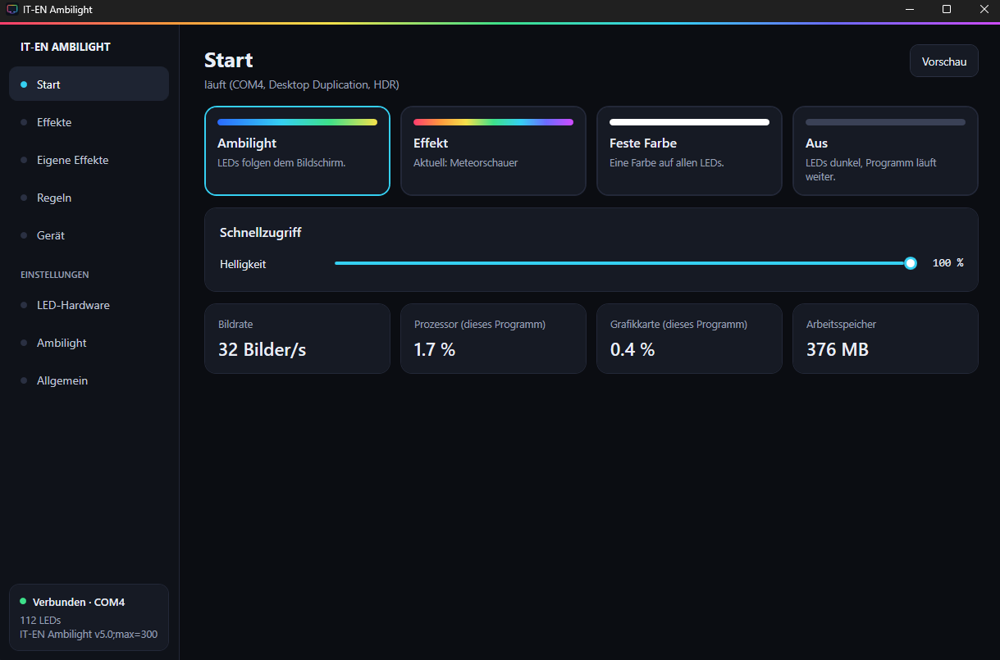
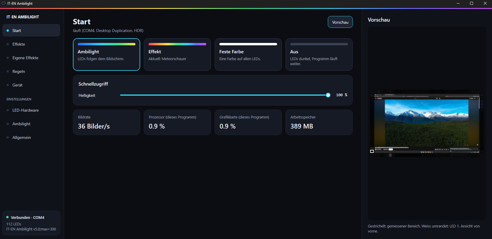
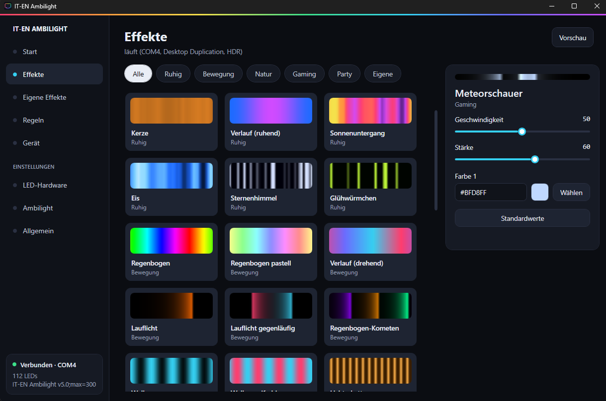
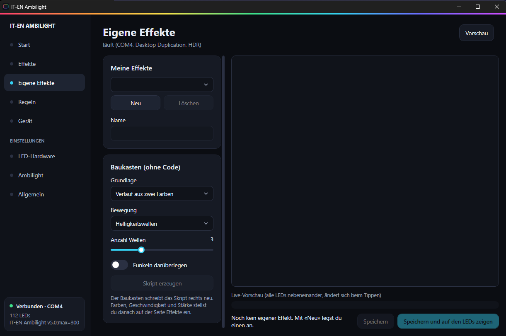
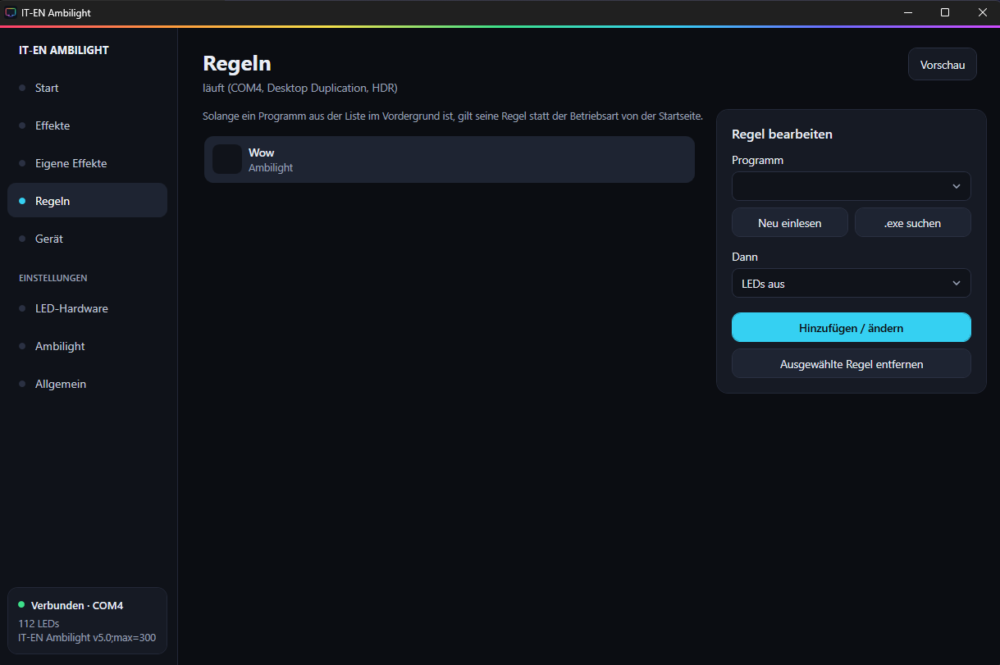
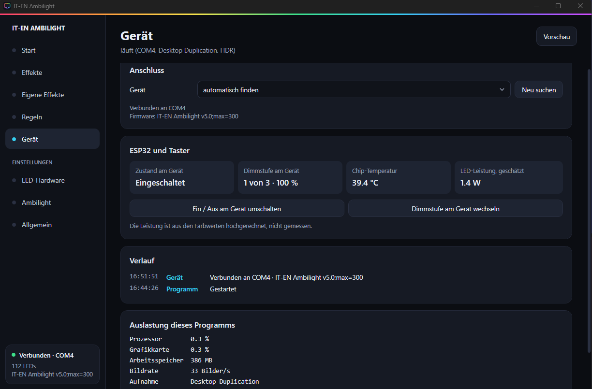
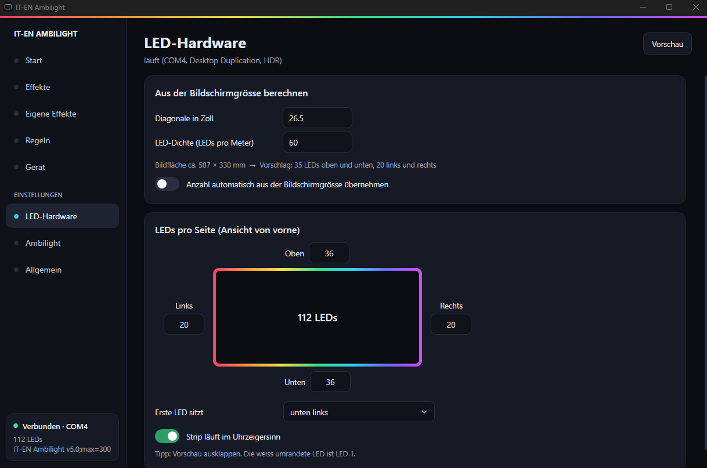
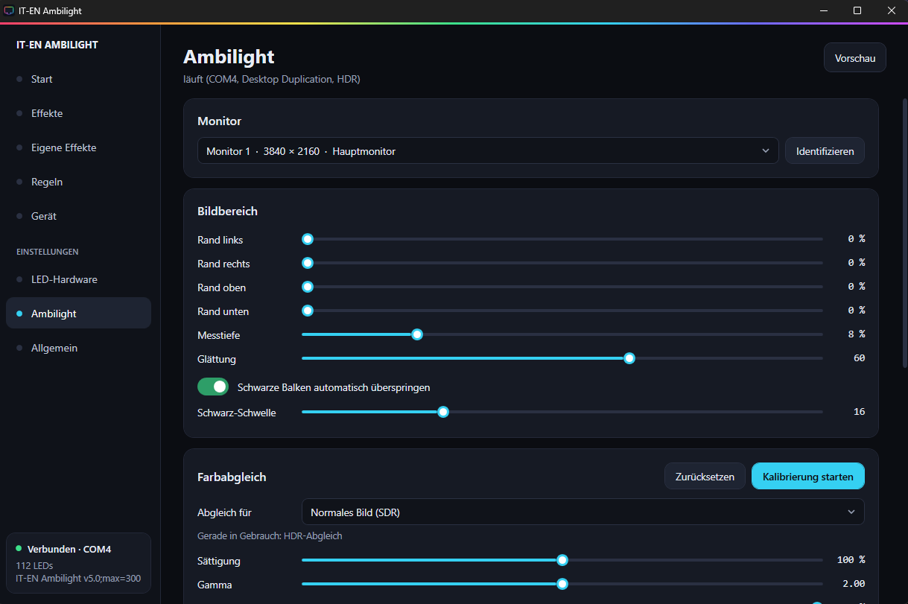
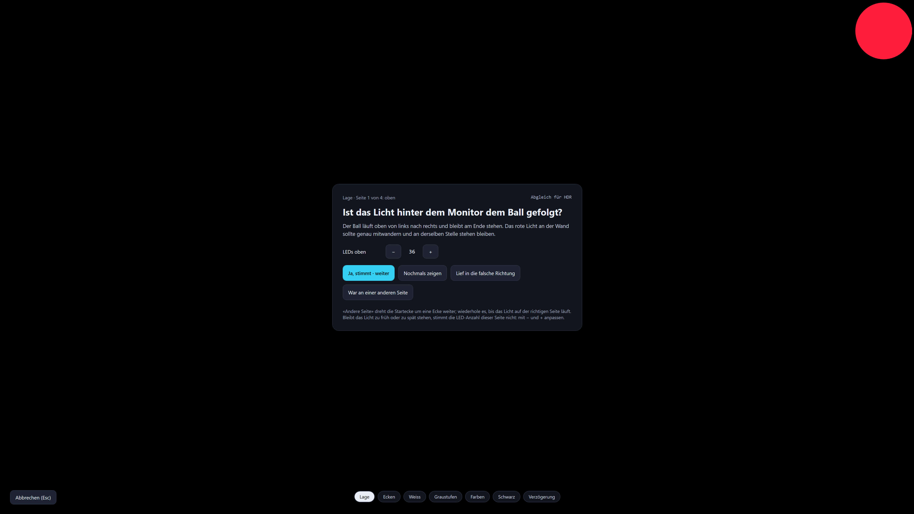

# IT-EN Ambilight

Eigenes Ambilight für den PC: ESP32-S3 + WS2812B, Steuerung per USB.
Die LEDs hinter dem Monitor folgen dem Bild, zeigen Effekte oder eine feste Farbe.

**Download:** die neueste `ItenAmbilight.exe` unter [Releases](https://github.com/BlugDeg/iten-ambilight/releases/latest).

## Vorschau

| Start | Start mit ausgeklappter Vorschau |
|---|---|
|  |  |

| Effekte | Eigene Effekte |
|---|---|
|  |  |

| Regeln pro Programm | Gerät |
|---|---|
|  |  |

| LED-Hardware | Ambilight |
|---|---|
|  |  |

| Kalibrier-Assistent |
|---|
|  |

## Inhalt
- `src/ItenAmbilight` – Windows-Programm (C#, .NET 8, WPF)
- `firmware/ambilight_v5_1` – aktuelle Firmware fürs ESP32-S3 (wie v5.0, zusätzlich «Bild halten» für den Ruhezustand)
- `firmware/ambilight_v5_0` – Vorgänger (Taster-Meldungen, Temperatur, Fernbedienung)
- `firmware/ambilight_v4_0` – Vorgänger (FastLED, Adalight, LED-Anzahl variabel bis 300)
- `firmware/ambilight_v3_1` – ältere Firmware (fest 112 LEDs)
- `firmware/diagnose` – Testprogramm (Strip rot/grün/blau, Taster, Statusmeldungen)

## Programm bauen
1. `ItenAmbilight.sln` in Visual Studio 2022 öffnen (Workload ".NET-Desktopentwicklung").
2. Start mit F5. Beim ersten Bauen lädt Visual Studio das Paket `System.IO.Ports`.
3. HyperHDR vorher beenden – der COM-Port kann nur von einem Programm benutzt werden.

Einstellungen liegen in `%AppData%\ItenAmbilight\settings.json`.
Start ohne Fenster (Autostart): `ItenAmbilight.exe --tray`

## Stand
**Etappe 1 (v0.1):** Bildschirmaufnahme (GDI), Monitor-Auswahl, LED-Berechnung aus der
Bildschirmgrösse, Randbeschnitt, Glättung, Helligkeit, Ausgabe per Adalight, Tray-Symbol, Vorschau.

**v0.2:** Aufnahme über die Desktop Duplication API (Verkleinerung auf der Grafikkarte),
GDI nur noch als Rückfall; Vorschau zeigt das aufgenommene Bild.

**Etappe 2 (v0.3):** Farbkalibrierung (Sättigung, Gamma, Weissabgleich Rot/Grün/Blau, Testfarbe),
automatische Erkennung schwarzer Balken, HDR-Aufnahme (16-Bit-Bild von Windows, Umrechnung auf den
normalen Bereich mit einstellbarem Weisspunkt).

**Etappe 3 (v0.4):** Betriebsarten Ambilight / Effekt / feste Farbe, sechs Effekte, Regeln pro Programm
(gilt, solange das Programm im Vordergrund ist), Start mit Windows, wählbare Messauflösung,
Anzeige der Firmware-Kennung (ab Firmware v4.0).

**v0.5:** Neue Oberfläche (dunkel, Seitenleiste, Seiten Start / Effekte / Regeln / Gerät / LED-Hardware /
Ambilight / Allgemein), ausklappbare Vorschau, Monitor identifizieren, Programmsymbole in den Regeln,
Anzeige von Prozessor, Grafikkarte und Arbeitsspeicher.

**v0.6:** Kalibrier-Assistent im Vollbild (Lage mit Ball, Ecken, Weiss, Graustufen, sechs Farben,
Schwarz-Schwelle, Verzögerung), getrennter Farbabgleich für SDR und HDR, 42 Effekte in fünf Kategorien mit
eigenen Reglern pro Effekt, eigene Effekte als Lua-Skript mit Baukasten und Live-Vorschau, Firmware v5.0
(Taster-Meldungen, Chip-Temperatur, geschätzte LED-Leistung, Ein/Aus und Dimmen per Programm), Verlauf.

**v0.7:** Update-Suche auf GitHub, automatische Releases, Programmsymbol; Bildrate bei ruhigem Bild, weniger Arbeitsspeicher.

**v0.8:** Das Programm läuft nur noch einmal (ein zweiter Start zeigt das Fenster des laufenden Programms),
Befehle per Kommandozeile (Stream Deck), globale Tastenkürzel (standardmässig unbelegt), Zeitplan
(standardmässig aus), Szenen für «PC gesperrt» und «Ruhezustand / Bildschirm aus» (Standard: LEDs aus),
Firmware v5.1.

Offen: Musik-Effekte, andere RGB-Geräte über OpenRGB, Tag/Nacht-Profile.

## Releases und Updates
- Ein Release entsteht automatisch, sobald ein Tag wie `v0.8.0` hochgeladen wird (`.github/workflows/release.yml`).
  Es enthält `ItenAmbilight.exe` (eine Datei, läuft ohne installiertes .NET) und `firmware.zip`.
- Das Programm fragt beim Start `github.com/BlugDeg/iten-ambilight` nach dem neuesten Release. Ist es neuer,
  fragt es nach und ersetzt nach einem Ja die eigene .exe. Das Repository steht in `Updater.cs` (`Repo`).
- Die Update-Suche findet Releases nur, wenn das Repository öffentlich ist.
- Programmsymbol: `app.ico` nach `src/ItenAmbilight/` legen, dann neu bauen.

## Steuerung von aussen (Stream Deck, Verknüpfungen, Skripte)
Läuft das Programm schon, führt ein weiterer Start mit Argumenten nur den Befehl aus und beendet sich wieder:

| Aufruf | Wirkung |
|---|---|
| `ItenAmbilight.exe --toggle` | Ein / Aus umschalten |
| `ItenAmbilight.exe --on` / `--off` | Einschalten / Ausschalten |
| `ItenAmbilight.exe --mode ambilight` | Betriebsart: `ambilight`, `effect` oder `color` |
| `ItenAmbilight.exe --effect fire` | Effekt wählen (Kennung oder Name), `next` / `prev` blättert |
| `ItenAmbilight.exe --brightness 60` | Helligkeit in Prozent, `+10` / `-10` ändert schrittweise |
| `ItenAmbilight.exe --color #FF8800` | Feste Farbe |
| `ItenAmbilight.exe --show` / `--quit` | Fenster öffnen / Programm beenden |

Mehrere Befehle in einem Aufruf sind möglich (`--mode effect --effect fire --brightness 40`).
**Stream Deck:** Aktion «System › Öffnen», bei «App / Datei» den Pfad in Anführungszeichen und dahinter den Befehl
eintragen. Schneller reagiert ein Tastenkürzel: auf der Seite «Steuerung» z. B. F13 bis F24 belegen und im
Stream Deck «System › Hotkey» verwenden. Die Seite «Steuerung» zeigt alle Zeilen mit dem richtigen Pfad zum Kopieren.

## Automatik
- **Zeitplan** (Seite «Automatik», standardmässig aus): Zeitfenster, in denen die LEDs aus sind oder mit fester
  Helligkeit laufen. Geht den Regeln und der Betriebsart vor; ein Fenster darf über Mitternacht gehen.
- **Szenen**: Was die LEDs zeigen, wenn der PC gesperrt ist bzw. wenn Windows den Bildschirm ausschaltet oder der PC
  schläft – aus (Standard), feste Farbe oder Effekt. Im echten Ruhezustand läuft das Programm nicht; das Gerät hält
  dann das letzte Bild (Firmware v5.1, und nur wenn der USB-Anschluss weiter Strom liefert).
- Reihenfolge: Kalibrier-Assistent › Szene › Zeitplan › Regel › Betriebsart. Ist das Programm ausgeschaltet, bleibt es aus.

## Eigene Effekte (Lua)
Ein Skript definiert `function led(i, pos, t, p)` und gibt eine Farbe zurück:
`i` = Nummer der LED (1..n), `pos` = Lage rund um den Monitor (0..1), `t` = Zeit in Sekunden,
`p.intensity` (0..1), `p.color1`, `p.color2`, `p.color3`, `p.n`.
Befehle: `rgb(r,g,b)`, `hsv(h,s,v)`, `mix(a,b,x)`, `scale(farbe,x)`, `wave(x)`, `noise(x,t)`, `clamp(x,lo,hi)`.
Optional wird `function frame(t, dt, p)` einmal pro Bild aufgerufen. Skripte laufen in einer Sandbox
(kein Dateizugriff) und werden bei einer Endlosschleife angehalten.

## Firmware v5.0 / v5.1
Befehle vom PC (Textzeile zwischen zwei Bildern): `!T` Zustand, `!OT` Ein/Aus umschalten, `!O1`/`!O0`,
`!BN` nächste Dimmstufe, `!B0`..`!B2`. Meldungen ans Programm: `#ST ...` (Zustand) und `#EV S|L ...` (Taster).
Neu in v5.1: `!H` = letztes Bild stehen lassen, bis wieder ein Bild kommt (für die Szene «Ruhezustand»), `!H0` hebt es auf.
Die Firmware v4.0 funktioniert weiter, liefert aber keine Meldungen.

## LED-Anzahl
Mit Firmware v4.0 ist die LED-Anzahl frei (1 bis 300). Die Firmware übernimmt die Anzahl aus den
Bildern, die das Programm schickt. Die ältere v3.1 nimmt nur genau 112 LEDs an.
